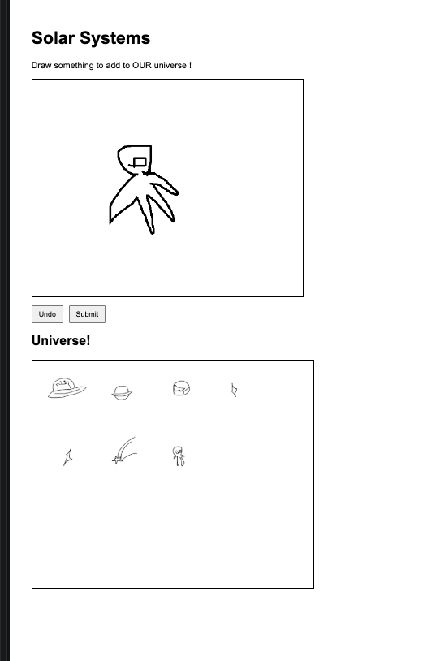

Solar Systems is a drawing website inspired by Draw a Fish in which it lets people draw their own planets, stars, aliens, and other space-related objects to contribute to a soon to be shared universe. In the future, the website will be filled with shared drawings submitted by different users through server hosting. 

Current Features 
* Drawing canvas: Drawing freely usign your mouse only in black. 
* Undo: Undo your strokes using Cmd + z or ctrl + z/clicking the undo button 
* Submit: Click the submit drawing to add your drawings. 
* Random positioning: Drawings are placed at random positions with checks to prevent overlap. 
* Canvas reset: After submission, the drawing board resets. 

Used: 
* Vite 
* React
* TypeScript 
* HTML 
* CSS

How to use it: 
1. Click the link: https://solar-systems-nine.vercel.app/
2. Start drawing your drawing
3. Submit your drawing

Demo
